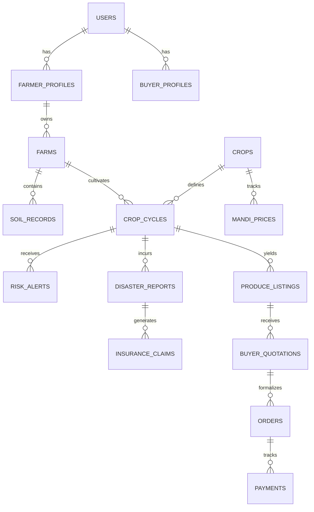

# AgriShield - Relational Database Schema Design

This document details the PostgreSQL + PostGIS relational schema powering the AgriShield backend, as well as the SQLite representation mirrored in the Android Room database.

---

## 1. Entity-Relationship Overview

---

## 2. Table Specifications

### 1. `users`
Core user identity and authentication credentials.
- `id` (UUID, Primary Key)
- `phone_number` (VARCHAR(15), Unique, Indexed)
- `full_name` (VARCHAR(100), Not Null)
- `role` (ENUM: `'farmer'`, `'buyer'`, `'fpo_officer'`, `'admin'`)
- `preferred_language` (VARCHAR(10), Default `'ta'`)
- `hashed_password` (VARCHAR(255), Not Null)
- `is_active` (BOOLEAN, Default TRUE)
- `created_at` (TIMESTAMPTZ, Default NOW())
- `updated_at` (TIMESTAMPTZ, Default NOW())

### 2. `farmer_profiles`
Farmer demographic and cooperative affiliation.
- `id` (UUID, Primary Key)
- `user_id` (UUID, FK -> `users.id`, Unique)
- `state` (VARCHAR(50), Default `'Tamil Nadu'`)
- `district` (VARCHAR(50), Not Null, Indexed)
- `block` (VARCHAR(50), Not Null)
- `village` (VARCHAR(50), Not Null)
- `fpo_membership_id` (VARCHAR(50), Nullable)
- `pm_kisan_id` (VARCHAR(50), Nullable)
- `created_at` (TIMESTAMPTZ)

### 3. `farms`
Land holdings and spatial polygons.
- `id` (UUID, Primary Key)
- `farmer_id` (UUID, FK -> `farmer_profiles.id`, Indexed)
- `farm_name` (VARCHAR(100), Default `'Main Plot'`)
- `area_acres` (NUMERIC(8,2), Not Null)
- `latitude` (NUMERIC(10,6), Not Null)
- `longitude` (NUMERIC(10,6), Not Null)
- `boundary_geom` (GEOMETRY(Polygon, 4326), Nullable)
- `soil_type` (VARCHAR(50), Not Null)
- `irrigation_type` (ENUM: `'drip'`, `'sprinkler'`, `'flood'`, `'rainfed'`)
- `water_source` (ENUM: `'borewell'`, `'open_well'`, `'canal'`, `'tank'`, `'none'`)
- `created_at` (TIMESTAMPTZ)

### 4. `crops`
Master catalog of agronomic traits and crop parameters.
- `id` (UUID, Primary Key)
- `crop_name` (VARCHAR(100), Not Null)
- `crop_name_ta` (VARCHAR(100), Not Null) -- Tamil display name
- `scientific_name` (VARCHAR(100))
- `category` (VARCHAR(50)) -- Vegetable, Grain, Pulse, Cash Crop
- `growth_duration_days` (INT, Not Null)
- `water_requirement_mm` (NUMERIC(8,2), Not Null)
- `ideal_soil_ph_min` (NUMERIC(3,1))
- `ideal_soil_ph_max` (NUMERIC(3,1))
- `average_yield_per_acre_kg` (NUMERIC(10,2))
- `average_cost_per_acre` (NUMERIC(10,2))
- `created_at` (TIMESTAMPTZ)

### 5. `crop_cycles`
Active or historical cultivation on a specific farm.
- `id` (UUID, Primary Key)
- `farm_id` (UUID, FK -> `farms.id`, Indexed)
- `crop_id` (UUID, FK -> `crops.id`, Indexed)
- `sowing_date` (DATE, Not Null)
- `expected_harvest_date` (DATE, Not Null)
- `allocated_acres` (NUMERIC(8,2), Not Null)
- `cultivation_method` (ENUM: `'conventional'`, `'organic'`, `'natural'`)
- `status` (ENUM: `'planned'`, `'sown'`, `'vegetative'`, `'flowering'`, `'harvesting'`, `'harvested'`, `'damaged'`)
- `created_at` (TIMESTAMPTZ)

### 6. `mandi_prices`
Daily market rates and arrivals across APMC mandis.
- `id` (UUID, Primary Key)
- `crop_id` (UUID, FK -> `crops.id`, Indexed)
- `state` (VARCHAR(50), Not Null)
- `district` (VARCHAR(50), Not Null)
- `market_name` (VARCHAR(100), Not Null)
- `variety` (VARCHAR(50))
- `arrival_date` (DATE, Not Null, Indexed)
- `min_price_per_quintal` (NUMERIC(10,2))
- `max_price_per_quintal` (NUMERIC(10,2))
- `modal_price_per_quintal` (NUMERIC(10,2), Not Null)
- `source_provenance` (VARCHAR(50), Default `'data.gov.in'`)
- `created_at` (TIMESTAMPTZ)

### 7. `risk_alerts`
Localized meteorological and biological early-warnings.
- `id` (UUID, Primary Key)
- `crop_cycle_id` (UUID, FK -> `crop_cycles.id`, Indexed)
- `severity` (ENUM: `'low'`, `'medium'`, `'high'`, `'critical'`)
- `alert_type` (ENUM: `'heavy_rainfall'`, `'cyclone'`, `'heat_stress'`, `'pest_outbreak'`, `'disease_blight'`)
- `title` (VARCHAR(200), Not Null)
- `title_ta` (VARCHAR(200), Not Null)
- `description` (TEXT, Not Null)
- `description_ta` (TEXT, Not Null)
- `action_plan` (TEXT, Not Null)
- `action_plan_ta` (TEXT, Not Null)
- `source_model` (VARCHAR(50), Not Null)
- `is_acknowledged` (BOOLEAN, Default FALSE)
- `valid_until` (TIMESTAMPTZ, Not Null)
- `created_at` (TIMESTAMPTZ)

### 8. `disaster_reports`
Post-disaster loss assessments and photo evidence.
- `id` (UUID, Primary Key)
- `crop_cycle_id` (UUID, FK -> `crop_cycles.id`, Indexed)
- `disaster_type` (ENUM: `'cyclone'`, `'flood'`, `'drought'`, `'pest_attack'`, `'hailstorm'`)
- `incident_date` (DATE, Not Null)
- `affected_area_acres` (NUMERIC(8,2), Not Null)
- `estimated_damage_percentage` (NUMERIC(5,2), Not Null)
- `photos` (JSONB, Default `'[]'`) -- Geotagged image URLs with EXIF metadata
- `notes` (TEXT)
- `status` (ENUM: `'submitted'`, `'verified_by_fpo'`, `'forwarded_to_dept'`, `'resolved'`)
- `is_within_72h_pmfby` (BOOLEAN, Not Null)
- `created_at` (TIMESTAMPTZ)

### 9. `insurance_claims`
Structured claim dossiers for PMFBY and SDRF.
- `id` (UUID, Primary Key)
- `disaster_report_id` (UUID, FK -> `disaster_reports.id`, Unique)
- `scheme_type` (ENUM: `'pmfby'`, `'sdrf'`, `'state_special'`)
- `policy_number` (VARCHAR(100), Nullable)
- `insurance_company_name` (VARCHAR(100), Nullable)
- `official_portal_url` (VARCHAR(255))
- `dossier_pdf_url` (VARCHAR(255))
- `claim_status` (ENUM: `'dossier_generated'`, `'reported_to_bank'`, `'survey_pending'`, `'approved'`, `'rejected'`)
- `created_at` (TIMESTAMPTZ)

### 10. `produce_listings`
Distressed, surplus, or industrial-grade produce for alternative buyer matching.
- `id` (UUID, Primary Key)
- `farmer_id` (UUID, FK -> `farmer_profiles.id`, Indexed)
- `crop_id` (UUID, FK -> `crops.id`, Indexed)
- `quantity_kg` (NUMERIC(10,2), Not Null)
- `quality_grade` (ENUM: `'grade_b_processing'`, `'grade_c_feed'`, `'salvageable_unclassified'`)
- `harvest_date` (DATE, Not Null)
- `shelf_life_days` (INT, Not Null)
- `min_expected_price_per_kg` (NUMERIC(8,2), Not Null)
- `location_district` (VARCHAR(50), Not Null)
- `photo_evidence_url` (VARCHAR(255))
- `safety_certified_non_rotten` (BOOLEAN, Not Null)
- `status` (ENUM: `'available'`, `'quoted'`, `'sold'`, `'expired'`)
- `created_at` (TIMESTAMPTZ)

### 11. `buyer_profiles`
Verified agro-processing factories, puree manufacturers, and FPOs.
- `id` (UUID, Primary Key)
- `user_id` (UUID, FK -> `users.id`, Unique)
- `business_name` (VARCHAR(150), Not Null)
- `buyer_category` (ENUM: `'food_processor'`, `'pulp_puree'`, `'sauce_pickle'`, `'feed_manufacturer'`, `'institutional'`)
- `gstin` (VARCHAR(15), Nullable, Indexed)
- `fssai_license` (VARCHAR(20), Nullable)
- `is_verified` (BOOLEAN, Default FALSE)
- `operating_districts` (JSONB)
- `address` (TEXT)
- `created_at` (TIMESTAMPTZ)

### 12. `buyer_quotations`
Official offers from buyers for produce listings.
- `id` (UUID, Primary Key)
- `produce_listing_id` (UUID, FK -> `produce_listings.id`, Indexed)
- `buyer_id` (UUID, FK -> `buyer_profiles.id`, Indexed)
- `offered_price_per_kg` (NUMERIC(8,2), Not Null)
- `procurement_terms` (ENUM: `'farmgate_pickup'`, `'delivered_to_factory'`)
- `estimated_transport_cost_per_kg` (NUMERIC(8,2), Default 0.0)
- `net_realization_per_kg` (NUMERIC(8,2), Not Null) -- Offered - Transport - Handling
- `valid_until` (TIMESTAMPTZ, Not Null)
- `status` (ENUM: `'pending'`, `'accepted'`, `'declined'`, `'expired'`)
- `created_at` (TIMESTAMPTZ)

---

## 3. Data Integrity & Spatial Indexes
- Spatial index on `farms.boundary_geom` using GiST.
- B-tree composite index on `mandi_prices (crop_id, district, arrival_date DESC)`.
- Foreign key constraints with `ON DELETE CASCADE` for dependent profiles.
