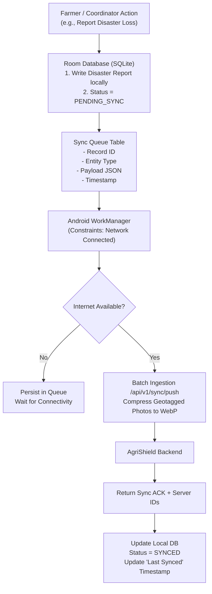

# AgriShield - Offline-First Architecture & Sync Design

## 1. The Rural Connectivity Reality in Indian Agriculture

In rural regions of Tamil Nadu (and broader India), farmers experience:
1. Intermittent 2G/4G connectivity with deep dead zones in field plots.
2. Low-cost Android smartphones with limited RAM (2GB - 4GB) and restricted storage.
3. High latency and packet drop rates.

**AgriShield Core Principle:** The application must be 100% functional for essential operations without an active internet connection.

---

## 2. Client-Side Data Architecture (Android)

---

## 3. Local Room Database Entities

1. `LocalFarmEntity`: Farm acreage, GPS coordinates, soil type, irrigation source.
2. `LocalCropCycleEntity`: Active crops, sowing dates, current phenological stage.
3. `LocalMandiCacheEntity`: Stored seasonal and recent APMC price records.
4. `LocalWeatherCacheEntity`: 7-day cached weather forecasts and active weather alerts.
5. `LocalDisasterReportEntity`: Offline loss reports, pending sync status, local photo file paths.
6. `SyncQueueEntity`:
   - `id`: Auto-incrementing primary key.
   - `entity_type`: `DISASTER_REPORT`, `CROP_CYCLE`, `PRODUCE_LISTING`.
   - `operation`: `CREATE`, `UPDATE`, `DELETE`.
   - `payload`: JSON serialized model.
   - `retry_count`: Integer.
   - `created_at`: Unix epoch millis.

---

## 4. Media & Geotag Handling

- Disaster evidence photos can be 5-10 MB each, causing upload timeouts.
- **On-Device Compression Pipeline:**
  1. Capture full-resolution photo via CameraX.
  2. Preserve original EXIF GPS tags (latitude, longitude, timestamp).
  3. Re-encode to high-efficiency WebP format at 80% quality, max dimension 1600px.
  4. Average resulting file size: **180 KB – 320 KB** (over 90% bandwidth reduction).
  5. Store on internal app storage until sync succeeds.

---

## 5. UI Staleness & Integrity Transparency

- **Stale Data Warning Banner:** If cached weather or price data is older than 24 hours, a clear orange banner is displayed:
  > *"காட்டப்படும் சந்தை விலை 2 நாட்களுக்கு முந்தையது (ஆஃப்லைன்). இணையம் கிடைக்கும்போது தானாகவே புதுப்பிக்கப்படும்."*  
  > *"Displayed mandi prices are 2 days old (Offline). Will refresh automatically when connected."*
- **Sync Status Pill:** Always visible in the top app bar:
  - 🟢 **பச்சை (Green):** ஒத்திசைக்கப்பட்டது (Synced - Just now).
  - 🟡 **மஞ்சள் (Yellow):** 2 பதிவுகள் காத்திருக்கின்றன (2 pending offline uploads).
  - 🔴 **சிவப்பு (Red):** ஆஃப்லைன் பயன்முறை (Offline Mode).

---

## 6. Field Coordinator Multi-Farmer Mode

Field coordinators (FPO staff, KVK volunteers) can assist multiple farmers:
- Coordinator logs in once.
- Can create and store profiles for 50+ village farmers locally.
- Gathers disaster reports in the field without connectivity.
- When returning to the FPO office with WiFi/4G, all queued reports sync automatically in a single batch.
