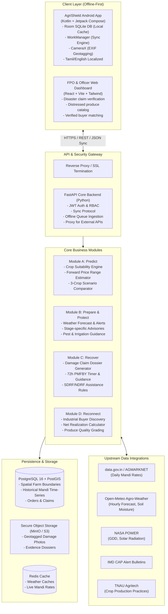

# AgriShield - System Architecture

## 1. High-Level Architectural Overview

AgriShield is architected as an **offline-first, cloud-synchronized decision-support and disaster-recovery ecosystem** designed specifically for Indian agriculture, starting with a pilot in Tamil Nadu (e.g. Dindigul, Thanjavur, Coimbatore districts).

---

## 2. Module Specifications

### Module A – Predict (Pre-Cultivation Decision Engine)
- **Input Parameters:** State, District, Block, Village, Farm Area (acres), Soil Type (Red Sandy Loam, Black Cotton, Clayey, Alluvial), Irrigation Source (Borewell, Open Well, Canal, Rainfed), Available Budget (₹), Sowing Date, Preference.
- **Suitability Scoring:** Multi-criteria weighted matrix combining soil pH/texture tolerance, water balance, and thermal requirements.
- **Forward Price Forecasting:** Calculates expected selling price at predicted harvest window (e.g., sowing + 90 days) using historical seasonal mandi variations.
  - Generates 3 scenarios: **Optimistic (75th percentile)**, **Normal (50th percentile)**, and **Pessimistic (25th percentile)**.
  - Predicts net profit = `(Estimated Yield * Harvest Price) - Cultivation Cost`.
  - Side-by-side comparison of 3 candidate crops.

### Module B – Prepare & Protect (During Cultivation Early-Warning)
- **Monitoring Horizon:** 7-day rolling forecast for localized coordinates.
- **Risk Detection Engine:**
  - Heavy Rainfall (>64.5 mm/24h) & Cyclone warnings.
  - High Temperature Heat Stress (>38°C during flowering/fruit set).
  - Soil Moisture Depletion (triggers irrigation advisory).
  - High Relative Humidity (>85%) + moderate temp (triggers fungal blight advisory e.g., Early/Late Blight in Tomato).
- **Localized Actionable Guidance:** In Tamil & English with specific cultural practices (drainage trenching, stake tying, biological sprays).

### Module C – Recover (Post-Disaster Loss & Insurance Assistance)
- **Incident Capture:** Farmer records damage date, geotagged photos, estimated area affected, and loss percentage.
- **PMFBY 72-Hour Calamity Timer:**
  - Under PMFBY operational guidelines, localized calamities (cyclone, inundation, hailstorm, landslide) must be reported within **72 hours** of occurrence.
  - The app calculates hours elapsed and urgency.
  - Generates a structured **PMFBY Loss Notification Claim Dossier**.
  - Provides direct one-tap dialing to the **14447** National Toll-Free Crop Insurance Helpline.
- **SDRF/NDRF Relief Norms:** Outlines Tamil Nadu State Disaster Response Fund compensation thresholds for input subsidies.

### Module D – Reconnect (Market Recovery & Buyer Discovery)
- **Produce Grading:**
  - *Grade A (Retail Prime):* Standard market supply.
  - *Grade B (Slightly Damaged / Visually Imperfect):* Suitable for food processing (puree, paste, sauce, ketchup, juice, dehydration).
  - *Grade C (Damaged / Broken):* Suitable for cattle feed or compost.
  - *Unsafe (Rotten / Mouldy):* Strictly rejected from food supply.
- **Net Realization Calculator:**
  $$\text{Net Realization} = (\text{Quantity} \times \text{Offered Price}) - \text{Transport Cost} - \text{Handling Cost}$$
- **Verified Buyer Directory:** Curated verified industrial food processors, FPOs, and bulk procurement agencies in Tamil Nadu (e.g. food parks in Nilakottai, Dindigul, Krishnagiri).

---

## 3. Communication & Offline Synchronization Protocol

1. **Local SQLite Room DB:** All read operations first query local cache. Writes are persisted immediately to local SQLite.
2. **Sync Queue:** Mutations (new farm, report damage, list produce) are saved in an offline `sync_queue` table with monotonic sequence IDs and client timestamps.
3. **WorkManager Exponential Backoff:** When network connectivity is regained, Android `WorkManager` delivers queued records in transactional batches to `/api/v1/sync/push`.
4. **Conflict Resolution:** Server utilizes `Last-Write-Wins` with audit logging and client state validation.
